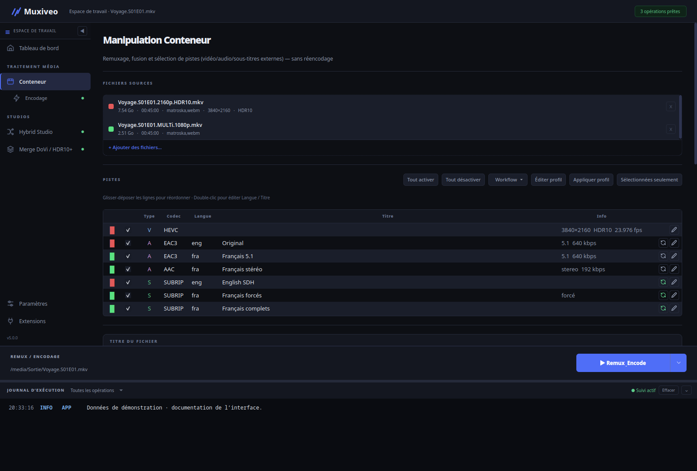
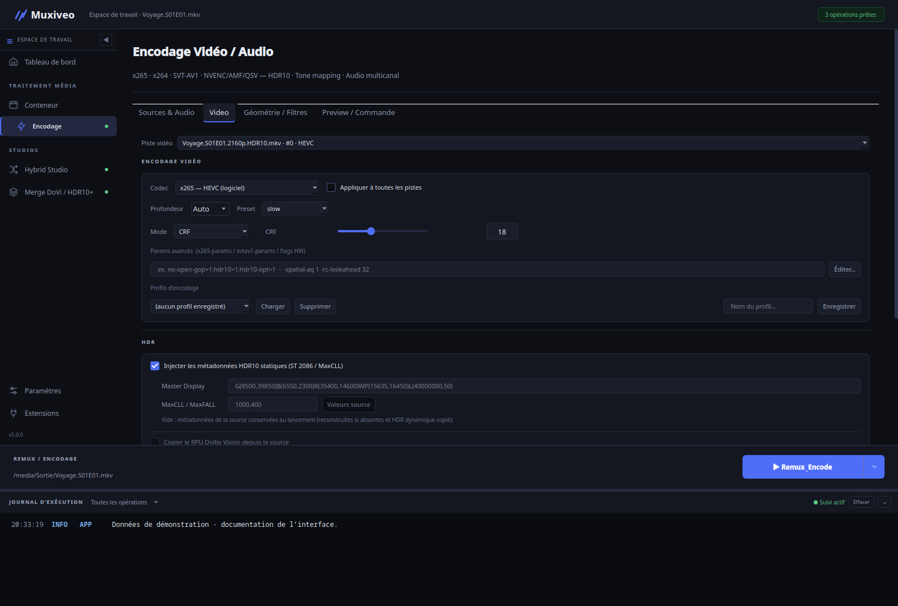
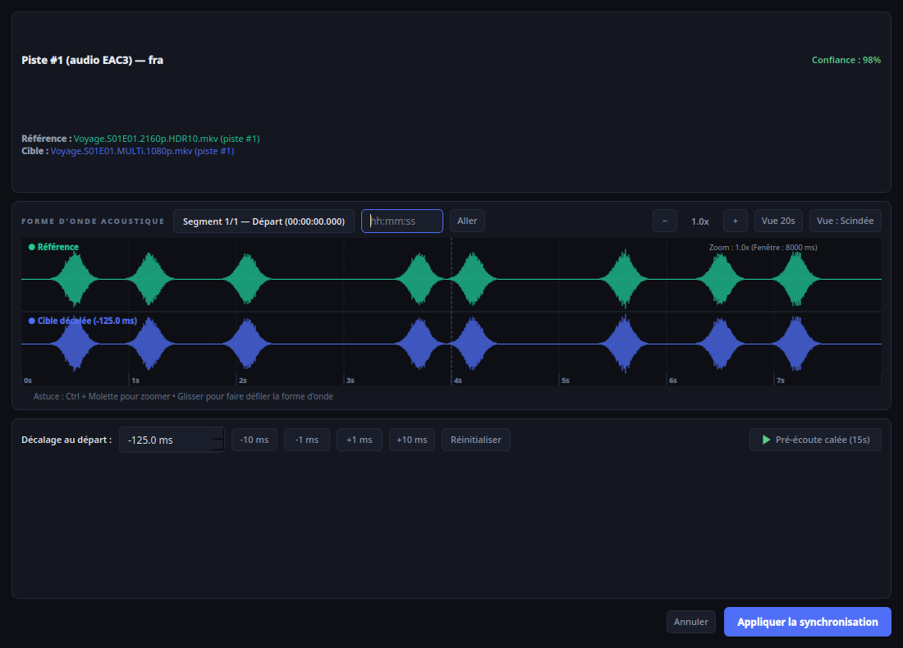
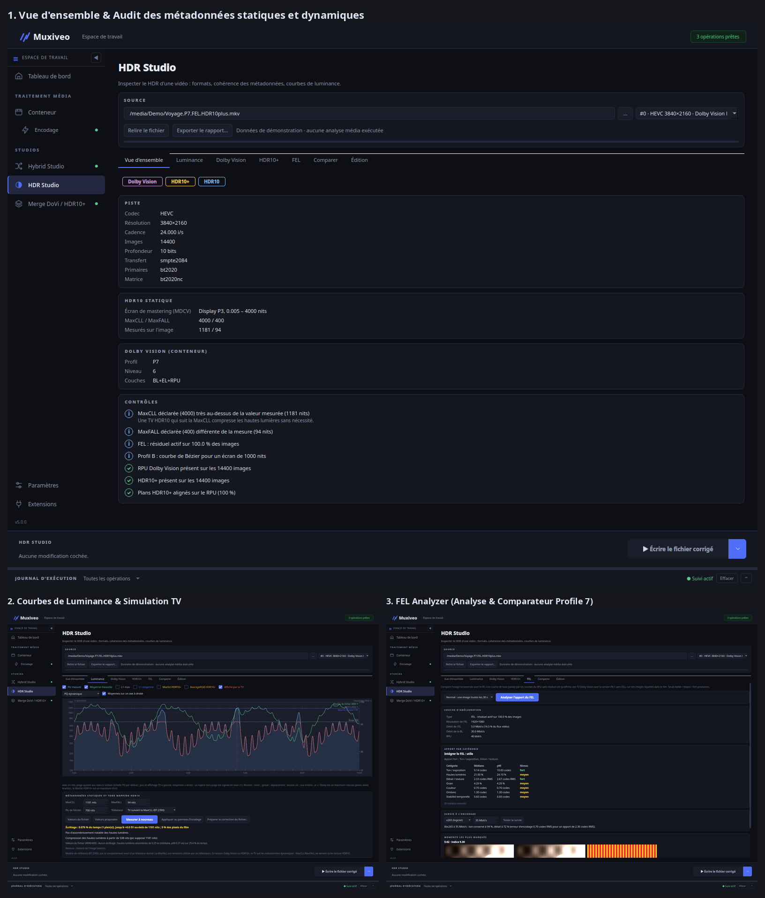
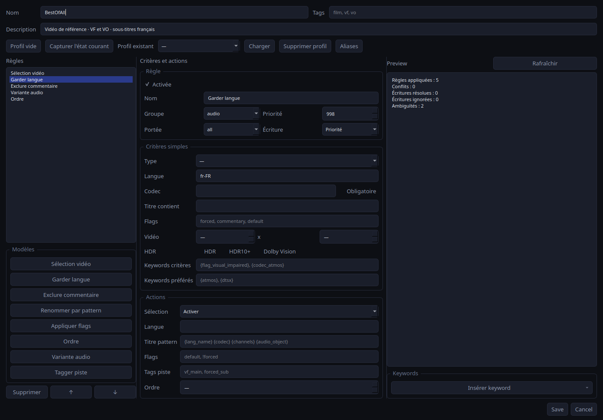
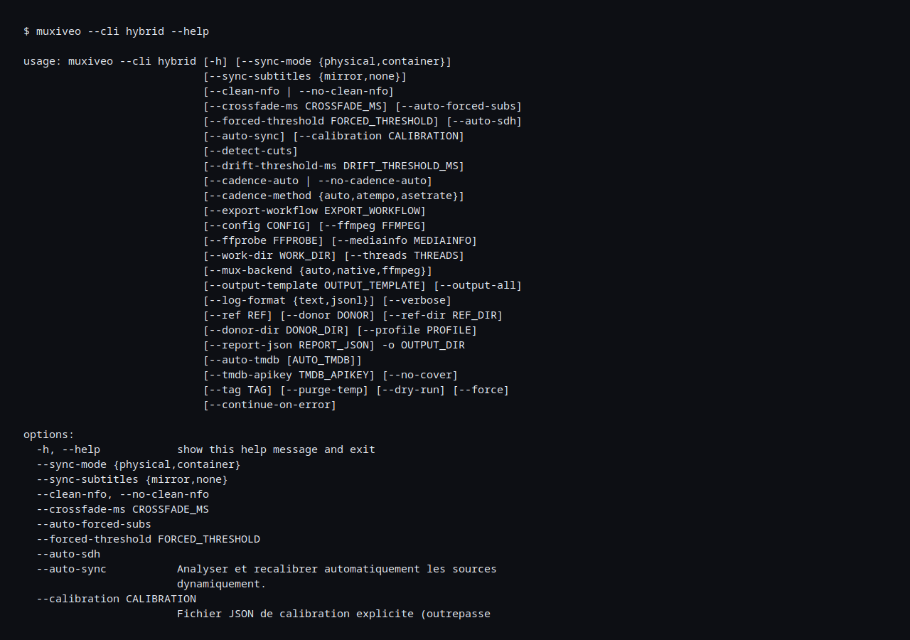

# 🎬 Muxiveo

Suite logicielle complète de préparation, remuxage sans perte et encodage vidéo/audio pour conteneurs MKV et MP4, intégrant la synchronisation acoustique multi-sources et un studio d'inspection et d'injection HDR / Dolby Vision.

> **La force de Muxiveo : le pipeline unifié en un seul clic.**  
> Là où le traitement vidéo impose d'ordinaire d'enchaîner 4 ou 5 logiciels différents (un outil de remuxage, un éditeur audio pour calculer les décalages, un encodeur vidéo, un injecteur Dolby Vision, un script d'interpolation), Muxiveo centralise l'ensemble du flux de production : **vous pouvez remuxer, réordonner vos pistes, éditer les métadonnées, synchroniser acoustiquement vos flux audio, injecter ou reconstruire le Dolby Vision / HDR10+, réencoder (GPU / CPU) et interpoler par IA en une seule et même exécution** — tout comme utiliser chacun de ces modules séparément selon votre besoin immédiat.

<div align="center">

**Français** | [English](README_EN.md)

[](https://github.com/Hydro74000/Muxiveo/releases)
[](#-téléchargement--installation-rapide)
[](LICENSE)
[](https://github.com/Hydro74000/Muxiveo/wiki)
[](https://discord.gg/YGAjNjZHQC)

<br/>

[](https://paypal.me/muxiveo)  
*Muxiveo est 100 % gratuit, open source et sans publicité. Vos dons soutiennent son développement indépendant.*

</div>

---

## 🧭 Guide d'orientation rapide

| Votre objectif | Module Muxiveo | Traitement | Guide dédié |
|---|---|---|---|
| **Agencer un fichier MKV** (pistes, langues, titres, chapitres, sous-titres) | **Conteneur** | Copie sans perte (*Copy*) | [Guide Conteneur & Remux](https://github.com/Hydro74000/Muxiveo/wiki/Interface-et-usage#conteneur--encodage) |
| **Compresser, changer de codec ou convertir le son** | **Encodage** | Encodage GPU / CPU | [Guide Encodage vidéo et HDR](https://github.com/Hydro74000/Muxiveo/wiki/Encodage-video-et-HDR) |
| **Marier une vidéo 4K et l'audio/subs d'une autre édition** | **Studio d'Hybridation** | Calage acoustique FFT (*Zero Delay*) | [Guide Hybridation & Synchro](https://github.com/Hydro74000/Muxiveo/wiki/Hybridation) |
| **Inspecter, mesurer ou corriger le HDR (MaxCLL, DoVi)** | **HDR Studio** | Analyse et édition sans réencodage | [Guide HDR Studio](https://github.com/Hydro74000/Muxiveo/wiki/HDR-Studio) |
| **Transférer Dolby Vision / HDR10+ entre deux fichiers** | **Fusion DoVi / HDR10+** | Injection de métadonnées sans perte | [Guide Fusion DoVi](https://github.com/Hydro74000/Muxiveo/wiki/Interface-et-usage#fusion-dovi--hdr10) |
| **Fluidifier les mouvements (24 → 60 i/s)** | **MVO-RIFE** (Extension) | Interpolation neuronale GPU | [Guide MVO-RIFE](https://github.com/Hydro74000/Muxiveo/wiki/Plugin-MVO-RIFE) |
| **Automatiser les choix sur une série ou un lot** | **Profils** / **CLI** | Profils décisionnels & scripts | [Guide Profils](https://github.com/Hydro74000/Muxiveo/wiki/Profils) & [Guide CLI](https://github.com/Hydro74000/Muxiveo/wiki/CLI-headless) |

---

## 📦 Téléchargement & Installation rapide

Des paquets autonomes intégrant l'ensemble des dépendances et outils nécessaires (`ffmpeg`, `mediainfo`, `dovi_tool`, `hdr10plus_tool`) sont disponibles sur la page des [Releases](https://github.com/Hydro74000/Muxiveo/releases) :

| Système | Format recommandé | Instructions de démarrage |
|---|---|---|
| **Linux** | **`Muxiveo-x86_64_allinc-*.AppImage`** | Rendre exécutable (`chmod +x`) et lancer. Tous les outils sont intégrés. Compatible avec *Gear Lever*. |
| **Windows** | **`Muxiveo-Setup-*.exe`** | Installateur complet. Détecte et configure automatiquement l'environnement et les outils. |
| **macOS** | **`Muxiveo-*.dmg`** | Paquet pour macOS (Intel et Apple Silicon). Outils système installés automatiquement via Homebrew si absents. |
| **Homebrew** | Formule Linux / macOS | `brew tap Hydro74000/muxiveo && brew install muxiveo` |

> [!TIP]
> **Intégration système** : Sur Linux, Windows et macOS, Muxiveo s'intègre automatiquement au menu contextuel *"Ouvrir avec..."* de votre explorateur de fichiers.
>
> 📖 Pour le détail des prérequis ou la résolution des accès dossiers Windows, consultez le [Guide d'installation complet](https://github.com/Hydro74000/Muxiveo/wiki/Installation) et le [Dépannage Windows](https://github.com/Hydro74000/Muxiveo/wiki/Troubleshooting-windows).

---

## 🎛️ Usage principal : Un pipeline unifié ou des outils à la carte

Muxiveo vous laisse une liberté totale d'exécution selon vos projets :
* **En une seule opération complète** : Préparez l'agencement des pistes dans **Conteneur**, définissez les traitements dans **Encodage**, ajustez le calage d'une piste audio par FFT ou appliquez une injection Dolby Vision, et lancez la totalité du flux en **un seul clic** via le bouton d'action unifié.
* **Ou séparément selon vos besoins** : Réalisez un simple remux sans perte en quelques secondes sans toucher à l'image, extrayez une piste de sous-titre, convertissez une piste audio de compatibilité, ou inspectez le HDR d'une vidéo de manière totalement autonome.



### 1. Remuxage sans perte (*Zero-Loss*)
Le remuxage prépare un fichier MKV propre en quelques secondes, sans aucune recompression :

* **Glisser-déposer universel** : Déposez un ou plusieurs fichiers (MKV, MP4, MOV, TS, sous-titres `.srt` / `.ass`, pistes audio séparées) directement dans la fenêtre.
* **Sélection et réordonnancement** : Activez ou désactivez les pistes en un clic, et déplacez-les pour définir l'ordre exact du conteneur final.
* **Normalisation des métadonnées de pistes** : Édition des langues avec sélection normalisée BCP47 (ex: `fr-FR`, `en-US`), renommage des titres de pistes et attribution des drapeaux Matroska (*Par défaut*, *Forcé*, *Malentendant*, *Commentaire*, *Original*).
* **Moteur Matroska natif** : Muxiveo embarque son propre multiplexeur EBML natif pour assembler les flux sans intermédiaire, préserver les structures de tags complexes et maximiser la rapidité, avec repli transparent sur FFmpeg si le traitement l'exige.
* **Nettoyage des sous-titres EIA-608/708** : Détection et élimination des sous-titres incrustés obsolètes (*Closed Captions*) sans décompresser la vidéo ni toucher aux métadonnées HDR.
* **Extraction rapide** : Export direct d'une piste audio ou d'un flux de sous-titres par clic droit dans la table.

### 2. Encodage sur-mesure & Accélération matérielle
Dès qu'une recompression ou une réduction de taille est requise, le panneau Encodage applique les réglages par piste :



* **Pipeline matériel GPU complet** :
  * Décodage et encodage matériel sans solliciter le processeur principal : `cuda` pour NVENC, `qsv` pour Intel QuickSync, `vaapi` pour Linux VAAPI, `d3d11va` pour AMD AMF.
  * Prise en charge des architectures **NVIDIA NVENC / NVEncC** (préréglages P1 à P7, modes CQP/VBR), **Intel QSV**, **AMD AMF** et **VAAPI** sous Linux (avec gestion fine des modes CQP et du niveau de compression).
* **Encodeurs logiciels de référence** : Intégration de `libx265`, `libx264` et `libsvtav1` (AV1) pour une efficacité d'encodage maximale.
* **Gestion du débit et de la taille finale** :
  * **Qualité constante** : Facteur de compression constant (CRF pour x264/x265/SVT-AV1, CQP pour NVENC/VAAPI).
  * **Taille cible (Mio)** : Définissez la taille exacte désirée pour le fichier complet. La calculatrice intégrée répartit automatiquement le budget débit entre la vidéo et l'audio, en distinguant les postes mesurés et estimés.
  * **Double passe** : Automatiquement activée en ciblage de taille pour les encodeurs logiciels (`x264`, `x265`, `SVT-AV1`).
* **Flexibilité audio avancée** :
  * Recopie sans perte (*passthrough*) des formats haute fidélité : Dolby TrueHD avec métadonnées spatiales Dolby Atmos, DTS-HD MA, DTS:X, FLAC.
  * Transcodage multicanal de haute qualité en **E-AC-3**, **AAC** ou **FLAC**.
  * **Variantes audio indépendantes** : Générez par exemple une piste stéréo ou un flux de compatibilité AC-3 5.1 à partir d'un master TrueHD Atmos sans modifier la piste source d'origine.

> 📖 Pour approfondir les options d'encodage, les filtres et les profils de compression, consultez le [Guide de l'encodage vidéo et HDR sur le Wiki](https://github.com/Hydro74000/Muxiveo/wiki/Encodage-video-et-HDR).

---

## 🔬 Modules spécialisés

### 🎙️ Studio d'Hybridation & Synchronisation acoustique
*Associez la meilleure source vidéo (ex: master UHD 4K) avec les pistes audio et sous-titres d'une autre édition (ex: VF d'un Blu-ray ou d'une diffusion TV).*



* **Alignement acoustique par corrélation FFT** : Muxiveo analyse le signal audio réel des deux sources pour calculer le décalage temporel exact à la milliseconde près, sans se fier aux métadonnées des conteneurs.
* **Visualiseur de formes d'ondes superposées** : Forme d'onde bicolore zoomable (référence VO en vert, donneur VF en bleu), navigation temporelle sur les transitoires sonores et pré-écoute instantanée pour valider le calage à l'oreille.
* **Compensation de cadence** : Détection et conversion automatique des écarts de vitesse de défilement (ex: conversion PAL 25 i/s vers cinéma 23.976 i/s par rééchantillonnage de débit audio).
* **Détection des coupures & Calibration multi-segments** : Localisation des coupures publicitaires ou variantes de montage TV avec découpage de la timeline en segments indépendants recalés séparément.
* **Synchronisation physique (*Zero Delay*)** : Décalage physique réel du flux audio (insertion de silence ou découpe au paquet près) et réalignement des sous-titres texte (SRT, ASS, VTT). Cette méthode évite les désynchronisations constatées sur les téléviseurs et barres de son qui ignorent les tags de décalage virtuel de conteneur.
* **Hybridation par lots** : Appariement automatique des fichiers d'une saison entière par détection des motifs d'épisodes (`S01E01`), avec calibration et traitement groupé.

> 📖 Consultez le [Guide d'hybridation et synchronisation](https://github.com/Hydro74000/Muxiveo/wiki/Hybridation) ainsi que la page [Qualité et dépannage audio](https://github.com/Hydro74000/Muxiveo/wiki/Synchronisation-qualite).

---

### 🌈 HDR Studio & Dolby Vision
*Inspection, audit, mesure réelle et manipulation des flux HDR statiques et dynamiques.*



* **Audit complet des métadonnées** : Visualisation instantanée des paramètres de mastering HDR10 (MDCV, MaxCLL/MaxFALL) et des métadonnées dynamiques Dolby Vision (RPU) et HDR10+. Détection des anomalies (comptages de trames incohérents, métadonnées génériques).
* **Mesure réelle sur l'image** : Calcul du MaxCLL et MaxFALL réels du métrage par analyse des pixels (mode rapide sur images clés en ~20 s, ou analyse intégrale).
* **Luminance et simulation d'affichage TV** : Courbes de luminance zoomables et simulation du rendu sur un téléviseur au pic réglable (100 à 10 000 nits) pour visualiser l'écrêtage et l'assombrissement.
* **Édition sans réencodage** : Correction des balises statiques HDR10, réalignement des blocs Dolby Vision L6/L11 et conversion du Profil 7 vers le Profil 8.1 universel.
* **FEL Analyzer & Intégration FEL (Extension mvo-fel)** :
  * Analyse de l'apport réel de la couche d'extension Full Enhancement Layer (Profil 7 FEL) par catégorie (ton, hautes lumières, détail, grain).
  * Comparateur avant/après en pleine résolution avec loupe et carte des écarts.
  * Reconstruction complète de l'image (Base Layer + Enhancement Layer) lors d'un réencodage pour ne perdre aucun détail du master original.
* **Fusion DoVi / HDR10+** : Injection des métadonnées dynamiques d'une édition vers le flux HEVC d'une autre édition avec validation de trames.

> 📖 Pour découvrir l'ensemble des contrôles et des outils de mesure, consultez le [Guide HDR Studio](https://github.com/Hydro74000/Muxiveo/wiki/HDR-Studio) et le [Guide de l'extension Merge FEL](https://github.com/Hydro74000/Muxiveo/wiki/Plugin-Merge-FEL).

---

### 🏎️ Fluidification d'image IA (MVO-RIFE)
*Multiplication de la cadence d'images par réseau de neurones avec accélération GPU.*

* **Cadences cibles** : Facteurs fixes (×2, ×3, ×4) ou normalisation cinéma vers haute cadence (23,976/24 → 59,94/60 i/s via facteur ×2.5).
* **Moteur hybride** : Associe le modèle d'interpolation RIFE v4, la compensation de mouvement par blocs et le flux optique matériel NVIDIA (NVOF). Un sélecteur entraîné choisit pour chaque zone de l'image le meilleur candidat afin d'éliminer les déformations sur les textures répétitives et les mouvements rapides.
* **Accélération TensorRT** : Extension optionnelle exploitant les cœurs Tensor des cartes NVIDIA RTX pour décupler la cadence d'inférence.

> 📖 Consultez le [Guide de l'interpolation MVO-RIFE](https://github.com/Hydro74000/Muxiveo/wiki/Plugin-MVO-RIFE) et l'[Accélération TensorRT](https://github.com/Hydro74000/Muxiveo/wiki/Plugin-TensorRT).

---

### 🏷️ Métadonnées TMDB & Fichiers NFO
* **Recherche intégrée TMDB** : Interrogation directe de la base The Movie Database pour films et séries avec détection automatique des saisons et épisodes.
* **Tags Matroska normalisés** : Renseignement automatique des champs officiels (`DATE_RELEASED`, `GENRE`, `DIRECTOR`, `CAST`, `SYNOPSIS`, `SEASON`, `EPISODE`).
* **Jaquettes haute résolution** : Téléchargement et intégration des affiches officielles sous forme de pièces jointes MKV.
* **Génération de fichiers `.nfo`** : Création automatique d'une fiche technique au format standard à côté du fichier exporté, compatible Plex, Jellyfin et Kodi.

---

### 🎯 Profils décisionnels & Automatisation
*Automatisez l'application de vos règles sur des dossiers complets.*



* **Règles conditionnelles réutilisables** : Définissez vos critères de sélection (ex: *"Sélectionner la meilleure VO Atmos et la meilleure VF EAC3/AC3, exclure les pistes de commentaires, activer le drapeau forcé sur les sous-titres appropriés"*).
* **Renommage par gabarits** : Formatez automatiquement les titres de pistes selon vos motifs personnalisés (ex: `{lang_name} {codec} {channels}`).
* **Éditeur visuel low-code** : Créez et ajustez vos profils directement dans l'interface avec prévisualisation en direct piste par piste, ou appliquez-les par lot en ligne de commande.

> 📖 Consultez le [Guide complet des profils](https://github.com/Hydro74000/Muxiveo/wiki/Profils).

---

## 💻 Utilisation en ligne de commande (CLI Headless)

Muxiveo intègre une CLI complète sans interface graphique, adaptée aux serveurs NAS, aux conteneurs et aux scripts d'automatisation :



```bash
# Remuxage simple avec métadonnées TMDB et profil décisionnel
muxiveo --cli remux -i source.mkv -o sortie_propre.mkv --profile "Standard" --auto-tmdb

# Hybridation automatique de deux sources avec calage acoustique FFT
muxiveo --cli hybrid --ref video_4k.mkv --donor audio_vf.mkv -o sorties/ --auto-sync

# Traitement par lots sur un dossier complet de série
muxiveo --cli batch --profile "Series" --input-dir "Saison 01" --output-dir "Sorties" --recursive --auto-tmdb

# Inspection détaillée du HDR et analyse de la couche Dolby Vision FEL
muxiveo --cli inspect master.mkv --hdr measure --hdr-fel
```

> 📖 Pour la liste complète des sous-commandes, arguments et schémas JSON, consultez la [Documentation de la CLI Headless](https://github.com/Hydro74000/Muxiveo/wiki/CLI-headless).

---

## 🛠️ Exécution depuis les sources

Pour exécuter ou contribuer au projet directement depuis les sources Python :

```bash
# 1. Cloner le dépôt
git clone https://github.com/Hydro74000/Muxiveo.git
cd Muxiveo

# 2. Installer les dépendances Python et vérifier les outils système
python3 setup.py

# 3. Lancer l'application
python3 main.py
```

*Prérequis : Python 3.10+ et PySide6 6.6.0+.*

---

## 💬 Communauté & Soutien

Muxiveo est un projet indépendant, **100 % gratuit, open source et développé sans aucune publicité**.

<div align="center">

### Rejoindre la communauté Discord

Pour poser vos questions, échanger sur les méthodes de remuxage et d'encodage, ou partager vos profils décisionnels :

[](https://discord.gg/YGAjNjZHQC)

---

### Soutenir le projet

Si Muxiveo vous fait gagner du temps au quotidien et que vous souhaitez encourager son développement continu :

[](https://paypal.me/muxiveo)

<a href="https://paypal.me/muxiveo">
  
</a>

</div>

---

## 📄 Licence & Crédits

Projet distribué sous licence **GNU General Public License v3.0**. Consultez le fichier [LICENSE](LICENSE) pour plus de détails.  
Muxiveo s'appuie sur des composants libres essentiels : `FFmpeg`, `MediaInfo`, `dovi_tool`, `hdr10plus_tool`, `NVEncC` et `PySide6`. Voir `NOTICE` et `SOURCES.md`.
