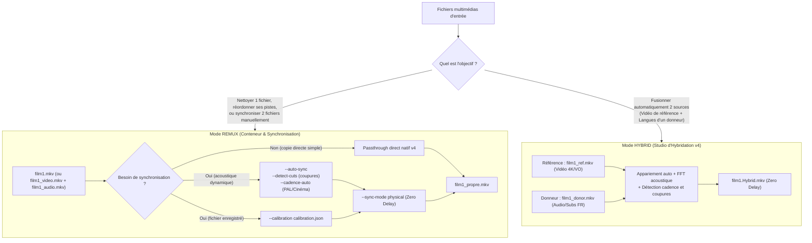

# Muxiveo CLI

`Muxiveo-cli` est le point d'entrée headless de Muxiveo. Il ne lance pas l'interface graphique et reste strictement non interactif.

## Guide par tâche

| Je veux… | Commande | Section |
|---|---|---|
| Inspecter une source, partir d'un job | `inspect`, `inspect --config-template` | [Contrat JSON](#contrat-json) |
| Remuxer (pistes, métadonnées, TMDB, profils) | `remux`, `run`, `batch`, `profile …` | [Contrat JSON](#contrat-json), [batch](#batch) |
| Encoder (vidéo, audio, HDR, débruitage, interpolation) | `encode`, `encode-preset` | [Encodage](#encodage--commande-encode-et-bloc-encode) |
| Extraire pistes, couches DV, HDR10+, pièces jointes | `extract`, `bluray-titles` | [Extraction](#extraction--commande-extract) |
| Inspecter ou corriger le HDR | `inspect --hdr`, `hdr-patch` | [Inspection HDR](#inspection-hdr-inspect---hdr) |
| Synchroniser (chaînes, calibrations, forme d'onde) | `--auto-sync-all`, `sources[i].sync`, `calibration`, `sync-scan` | [Synchro en chaîne](#synchro-en-chaîne--sourcesisync) |
| Hybrider une saison | `hybrid` | [Cas 2](#cas-2--hybrid-le-studio-dhybridation-headless-v4) |
| Profils, TMDB, Blu-ray | `profile`, `tmdb`, `bluray-titles` | [TMDB, profils, Blu-ray](#tmdb-profils-enregistrés-blu-ray) |
| Configurer, nettoyer, NVEncC, mettre à jour | `config`, `workdir`, `nvencc`, `version --install` | [Administration](#administration--configuration-dossier-de-travail-nvencc) |
| Piloter Muxiveo depuis un programme | `call`, `operations`, `--log-format events` | [api.md](api.md) |

Aide intégrée : `muxiveo --cli help COMMANDE`, `help --all` ; référence complète : [reference.md](reference.md).

## Lancement

```bash
python3 main.py --cli --help
./Muxiveo-cli --help
```

Dans les builds packages, le CLI utilise le même bundle que l'application GUI :

- Windows : entrée console `Muxiveo-cli.exe` à côté de `Muxiveo.exe` (même bundle ;
  `--cli` implicite). C'est elle qu'il faut utiliser depuis cmd/PowerShell : `Muxiveo.exe`
  est un exécutable graphique, sans sortie ni code retour dans une console interactive.
  L'installeur n'ajoute pas le dossier au `PATH` :
  `"C:\Program Files\Muxiveo\Muxiveo-cli.exe" version` ;
- Linux / macOS : `Muxiveo --cli ...` (AppImage : `./Muxiveo-x86_64.AppImage --cli ...`).

Depuis les sources, `python3 main.py --cli ...` lance aussi le mode CLI sans initialiser l'interface graphique.

## Commandes

| Commande | Rôle |
|---|---|
| `inspect` | inspecte une source et sort du JSON |
| `inspect --config-template` | génère un template JSON de départ |
| `inspect --hdr static\|dynamic\|measure` | inspection HDR (HDR Studio) : contrôles, métadonnées, courbes ; comparaison et rapport HTML/JSON |
| `schema` | affiche le schéma JSON public du contrat CLI (`--version api` : catalogue des opérations de la couche de service) |
| `tools` | affiche en JSON les chemins d'outils effectivement résolus par Muxiveo |
| `version [--check] [--channel stable\|unstable]` | affiche la version ; `--check` la compare à la dernière release du canal (stable = `main`, unstable = pré-versions `devel-cli`) |
| `validate` | valide un job/template sans exécuter ffmpeg |
| `preview` | affiche la commande ffmpeg prévue |
| `remux` | exécute un remux headless |
| `batch` | applique un template à plusieurs jobs |
| `validate --profile` | valide un `decision-profile`, ou son application si `-i` est fourni |
| `preview --profile` | applique un profil en dry preview JSON/commande |
| `run/remux --profile` | applique un profil et remuxe |
| `batch --profile` | applique un profil à un dossier |
| `hybrid` | hybridation (moteur du Hybrid Studio) : sources à rôles, appariement, recette, plan, exact-jobs ; voir « Cas 2 » |
| `sync-scan` | corrélation acoustique FFT et extraction de calibration |
| `shift-subs` | recalage physique de fichiers sous-titres (SRT, ASS) |
| `encode` | encode (job + bloc `encode` ou options d'encodage), ou aperçus `--preview-image/--preview-video` ; voir « Encodage » |
| `encode-preset list\|show\|save\|import\|export\|delete` | presets d'encodage (communs avec l'interface) |
| `extract` | extrait des pistes, couches Dolby Vision (EL, BL, RPU), HDR10+ ou pièces jointes ; voir « Extraction » |
| `hdr-patch` | corrige les métadonnées HDR sans réencodage (onglet Édition du HDR Studio) ; voir « Inspection HDR » |
| `help [COMMANDE]`, `help --all`, `help --format md` | aide complète (traduite selon `[ui] language`), référence Markdown |
| `tmdb search\|details`, `profile list\|show\|save\|delete\|capture`, `bluray-titles` | TMDB, profils enregistrés, titres d'un Blu-ray ; voir « TMDB, profils enregistrés, Blu-ray » |
| `config path\|show\|get\|set\|unset\|reset`, `workdir list\|clean`, `nvencc status\|install\|update\|remove` | administration ; voir « Administration » |
| `calibration show\|edit\|compose\|invert`, `sync-waveform` | calibrations de synchro (éditions du Synchro Studio), forme d'onde ; voir « Synchro en chaîne » |
| `capabilities [--section …]` | capacités de la machine : encodeurs, préréglages, Vulkan, NVOF, TensorRT, moteur MVO |
| `operations [--json] [--describe OPÉRATION]` | liste les opérations de la couche de service, ou décrit l'une d'elles (schémas de requête et de résultat, erreurs) |
| `call OPÉRATION --request FICHIER\|-` | appelle une opération avec une requête JSON stricte : réponse JSON sur stdout, événements sur stderr |

Exemples :

```bash
Muxiveo-cli inspect source.mkv
Muxiveo-cli inspect source.mkv --config-template --output sortie.mkv
Muxiveo-cli inspect film.mkv --hdr dynamic --hdr-report film.hdr.html
Muxiveo-cli inspect web.mkv bluray.mkv --hdr dynamic --hdr-compare --hdr-report comparaison.html
Muxiveo-cli inspect --hdr static --hdr-fail-on warn *.mkv
Muxiveo-cli schema --output Muxiveo-cli.schema.json
Muxiveo-cli schema --version decision-profile
Muxiveo-cli tools
Muxiveo-cli version --check --log-format jsonl
Muxiveo-cli version --check --channel unstable
Muxiveo-cli preview --config docs/cli/middle.json
Muxiveo-cli preview --config docs/cli/middle.json --json
Muxiveo-cli validate --config docs/cli/middle.json --json
Muxiveo-cli remux -i source.mkv -o sortie.mkv
Muxiveo-cli remux --config docs/cli/middle.json --dry-run
Muxiveo-cli batch --template docs/cli/complexe-toutes-options-template.json --batch docs/cli/complexe-toutes-options-batch.json --force
Muxiveo-cli batch --template template.json --batch batch.json --dry-run --log-format jsonl
Muxiveo-cli batch --template template.json --batch batch.json --summary summary.json
Muxiveo-cli batch --template exact-job.json --input-dir "Serie/Saison 01" --output-dir "out/Saison 01" --dry-run
Muxiveo-cli batch --template exact-job.json --input-dir "Serie" --recursive --include "*.mkv" --exclude "*sample*" --output-dir "out"
Muxiveo-cli batch --template exact-job.json --input-dir "Serie" --recursive --output-dir "out" --auto-tmdb
Muxiveo-cli batch --template exact-job.json --input-dir "Serie" --recursive --output-dir "out" --auto-tmdb \
    --output-template "{title}.S{season}E{episode}.{episode_title}-{group}"
Muxiveo-cli preview --profile profil.json -i source.mkv --json
Muxiveo-cli run --profile profil.json -i source.mkv -o sortie.mkv
Muxiveo-cli batch --profile profil.json --input-dir "Serie" --recursive --output-dir "out" --auto-tmdb --dry-run
```

## Contrat JSON

Les deux contrats publics principaux sont :

- `kind: "exact-job", version: 1` pour un traitement strict;
- `kind: "decision-profile", version: 1` pour l'automapping low-code.

Le schéma peut être exporté avec `Muxiveo-cli schema`.

Job minimal :

```json
{
  "version": 1,
  "kind": "exact-job",
  "sources": [
    {"path": "source.mkv"}
  ],
  "output": "sortie.mkv"
}
```

Règles de lecture communes à la CLI et à la GUI :

- les fichiers JSON sont lus en UTF-8, avec ou sans BOM ; les constantes non
  standard `NaN`, `Infinity` et `-Infinity` sont refusées ;
- un chemin relatif écrit dans un document JSON (`sources`, `input`,
  `extra_attachments`, `chapters.import`, `output`) est résolu depuis le
  **dossier de ce document**, pas depuis le répertoire courant. Le template,
  le job (`--config`) et le fichier `--batch` sont résolus chacun depuis leur
  propre dossier, avant fusion ;
- un chemin passé en ligne de commande (`-i`, `-o`, `--output-dir`…) reste
  relatif au répertoire courant ; `output_template` n'est pas un chemin.

Un JSON qui comptait sur le répertoire courant pour ses chemins relatifs doit
être lancé avec des chemins absolus, ou recevoir ses chemins en ligne de commande.

La sortie remux est exclusivement `.mkv`. Le champ additif `mux_backend` est
facultatif et son absence conserve tous les jobs v1 existants :

```json
{
  "version": 1,
  "kind": "exact-job",
  "sources": [{"path": "source.mkv"}],
  "output": "sortie.mkv",
  "mux_backend": "auto"
}
```

- `auto` inspecte le plan complet, choisit le writer natif lorsqu'il peut tenir
  le contrat et journalise tout repli FFmpeg avec sa raison exacte ;
- `native` est strict et ne replie jamais ;
- `ffmpeg` conserve le chemin historique.

`--mux-backend auto|native|ffmpeg` surcharge le job pour `validate`, `preview`,
`run`, `remux`, `batch` et les variantes basées sur un profil. La préférence
persistée `[matroska] mux_backend = auto` ne remplace pas un choix explicite du job.

### `sources`

Chaque source peut être une chaîne ou un objet :

```json
{
  "path": "source.mkv",
  "attachments": "none",
  "copy_tags": false
}
```

`attachments` accepte :

- `"none"` ou `false`;
- `"all"` ou `true`;
- une liste de noms ou indices.

#### Synchro en chaîne : `sources[i].sync`

Comme les références du panneau Conteneur : la source est mesurée face à une piste d'une autre
source, et suit la position de cette référence dans la sortie (références en chaîne composées,
résolues dans l'ordre des dépendances ; boucle refusée).

```json
"sources": [
  {"path": "uhd.mkv"},
  {"path": "bluray.mkv", "sync": {"reference": 0}},
  {"path": "vf.mkv", "sync": {"reference": 1, "reference_track": "a:0", "mode": "deep"}},
  {"path": "vo.mkv", "sync": {"reference": 0, "offset_ms": -120}}
]
```

| Champ | Effet |
|---|---|
| `reference` | index de la source de référence (défaut 0) |
| `reference_track` | piste de référence : `mkv_tid` ou `a:N` / `s:N` (défaut : première audio) |
| `track` | piste mesurée (défaut : audio de la source dans la langue de la référence, hors commentaire) |
| `mode` | `auto` (réglage `[sync] quick_audio_check`), `quick` (synchro rapide), `deep` (approfondie) |
| `type` | `auto`, `audio` (corrélation acoustique) ou `subtitle` (sous-titres) |
| `calibration` / `offset_ms` | synchro relative donnée (objet, fichier JSON, ou décalage constant) : aucune mesure |

`--auto-sync-all` (ou `"auto_sync_all": true`) ajoute `{"reference": 0}` à chaque source ≥ 1 sans
bloc ; `--auto-sync` reste limité à la source 1. Synchro propre à une piste (« Synchroniser cette
piste », elle seule bouge) : `tracks[i].sync` (mêmes champs, sans `track`), prioritaire sur la synchro
de sa source. Exemple : `docs/cli/examples/sync-links.json`.

#### Calibrations : `calibration`, `sync-waveform`

Mêmes éditions que le Synchro Studio (instants de sortie en ms ou `HH:MM:SS.mmm`, appliquées dans
l'ordre de la ligne de commande) :

```bash
Muxiveo-cli calibration show calib.json
Muxiveo-cli calibration edit calib.json --cut 600000-602500 --silence 1:00:00-1:00:04 \
    --shift-from-segment 2:-120 -o calib2.json
Muxiveo-cli calibration edit calib.json --cadence-method auto --resolve-cadence ref.mkv:1 cible.mkv:2 -o c.json
Muxiveo-cli calibration compose mesure.json position-reference.json -o synchro.json
Muxiveo-cli calibration invert synchro.json -o inverse.json
Muxiveo-cli sync-waveform -i film.mkv --stream 0:a:0 --start 1:00:00 --duration 30 --resolution-ms 10
```

`--remove-junction N` retire la jonction du segment N, `--shift-ms MS` fixe le départ (toute la
suite suit), `--shift-from-segment N:MS` fixe le segment N en reportant l'écart sur les suivants.
`sync-waveform` publie les pics d'amplitude par tranche (données d'un client graphique) ; la
pré-écoute reste propre à l'interface.

### `decision-profile`

Un profil décisionnel ne contient ni source ni sortie. Il décrit des règles
réutilisables :

```json
{
  "version": 1,
  "kind": "decision-profile",
  "name": "VF + VO",
  "variables": {
    "aliases": {
      "*": {
        "EAC3": "DDP",
        "AC3": "Dolby Digital"
      },
      "lang_name": {
        "French": "Français"
      }
    }
  },
  "groups": [
    {"id": "audio", "label": "Audio", "enabled": true, "priority": 200}
  ],
  "rules": [
    {
      "id": "rename_fr",
      "label": "Renommer VF",
      "group_id": "audio",
      "priority": 100,
      "write_mode": "priority",
      "scope": "all",
      "match": {
        "all": [
          {"field": "type", "op": "is", "value": "audio"},
          {"field": "language", "op": "is", "value": "fr-FR"},
          {"field": "source_title", "op": "contains", "expr": "(VFQ | VFF) & !Commentary", "required": false}
        ]
      },
      "actions": [
        {"type": "set_enabled", "value": true},
        {"type": "set_title", "pattern": "{lang_name} {codec} {channels} {audio_object}"},
        {"type": "remove_track_tags", "value": ["old_tag"]}
      ]
    }
  ]
}
```

`write_mode` définit ce qui se passe si plusieurs règles écrivent le même champ :

- `"priority"` : la plus forte priorité gagne; une priorité égale reste un conflit;
- `"override"` : cette règle remplace une valeur déjà proposée;
- `"add"` : cette règle complète sans écraser; pour un titre, le fragment est ajouté.

Les expressions acceptent aussi `!` en raccourci et `NOT(...)` pour exclure un critère.
Le keyword `{none}` cible une valeur vide dans le champ courant. Les actions
`remove_track_tags` sont appliquées avant les `add_track_tags` de la même règle.

Les conditions peuvent utiliser soit `value`, soit `expr`. `expr` accepte la
même syntaxe que l'éditeur de profils :

```json
{"field": "source_title", "op": "contains", "expr": "(VFQ | VFF) & Forced"}
```

Dans une expression :

- `&` signifie AND;
- `|` signifie OR;
- les parenthèses fixent la priorité;
- les atoms `{atmos}` ou `{dtsx}` ciblent les keywords booléens correspondants;
- les champs restent combinés entre eux par AND dans un bloc `all`.

Pour chercher `&`, `|`, `(` ou `)` comme texte réel, utilisez des guillemets ou
un échappement :

```json
{"field": "source_title", "op": "contains", "expr": "\"A | B\" | Dolby \\& DTS"}
```

Une condition qui contient à la fois `value` et `expr` est invalide.

Commandes :

```bash
Muxiveo-cli validate --profile profil.json
Muxiveo-cli preview --profile profil.json -i source.mkv --json
Muxiveo-cli run --profile profil.json -i source.mkv -o sortie.mkv
Muxiveo-cli batch --profile profil.json --input-dir "Serie" --recursive --output-dir "out"
```

`--profile` accepte soit un chemin complet, soit le nom d'un profil enregistré
dans `<dossier de config muxiveo>/profiles/decision/`. L'extension `.json`
est optionnelle : `--profile BestOfAll` cherchera aussi `BestOfAll.json`.

Keywords de renommage disponibles :

```text
{type} {source_index} {track_index}
{language} {lang} {lang_name} {source_language}
{title} {source_title}
{codec} {codec_raw} {codec_name} {channels} {channel_layout} {audio_object} {atmos} {dtsx}
{resolution} {width} {height} {hdr} {video_flags_hex}
{video_hdr} {video_hdr10} {video_hdr10plus}
{video_dolby_vision} {video_hlg} {video_sdr}
{flags} {flag_enabled} {flag_default} {flag_forced}
{flag_hearing_impaired} {flag_visual_impaired}
{flag_original} {flag_commentary}
{track_tags}
```

`variables.aliases` remplace des valeurs au rendu des patterns de titre et des
templates de sortie :

```json
{
  "variables": {
    "aliases": {
      "*": {"EAC3": "DDP"},
      "lang_name": {"French": "Français"}
    }
  }
}
```

- `*` est global.
- `lang_name`, `codec`, `codec_name`, etc. ciblent un keyword précis.
- priorité : alias ciblé > alias global > valeur originale.
- matching insensible à la casse et aux espaces de bord.
- pas de remplacement récursif.
- les aliases n'affectent pas les critères décisionnels.

`variables.codec_names` reste lu pour compatibilité avec les anciens profils,
mais les nouveaux profils doivent utiliser `variables.aliases`. Pour forcer le
codec technique brut, utilisez `{codec_raw}`.

`{lang_name}` masque la région pour la variante d'origine et la conserve entre
parenthèses pour les variantes régionales non standard :

| Langue | `{lang_name}` |
|---|---|
| `fr-FR` | `French` |
| `fr-CA` | `French (Canada)` |
| `pt-PT` | `Portuguese` |
| `pt-BR` | `Portuguese (Brazil)` |

### `tracks`

Les edits explicites modifient une piste ciblée par index ou par sélecteur :

```json
{
  "tracks": [
    {
      "source": 0,
      "id": 2,
      "enabled": true,
      "language": "fr-FR",
      "title": "French EAC3 5.1 Atmos",
      "flags": {"default": true},
      "time_shift_ms": 0
    }
  ]
}
```

`sync_calibration` (objet au format de `sync_calibrations`, facultatif) : synchro
propre à la piste, prioritaire sur celle de sa source. Le panneau Conteneur
l'écrit pour un sous-titre synchronisé seul avec `sync_subtitles: "none"`
(coupures ou cadence) : le sous-titre est réécrit, l'audio de sa source n'est
pas touché.
À l'import, une calibration de piste différente de celle de sa source (audio,
sous-titre en miroir) est conservée : la piste ne suit plus sa source jusqu'à
l'annulation de sa synchro.

### `track_order`

`track_order` permet de fixer l'ordre de sortie après filtrage. Chaque entrée
peut être un objet ou un tableau court :

```json
{
  "track_order": [
    {"source": 0, "id": 0},
    [0, 2]
  ]
}
```

Les erreurs de forme sont reportees avec le chemin exact, par exemple
`track_order[1][1]`.

### `chapters`

```json
{
  "chapters": {
    "source_index": 0,
    "include_source": true,
    "import": "chapters.ffmetadata",
    "add": [
      {"timestamp": "00:00:00.000", "chaptername": "Opening"}
    ]
  }
}
```

Imports acceptes :

- JSON avec `chapters` ou `entries`;
- ffmetadata;
- OGM simple.

### `tmdb`

TMDB est opt-in. Aucun appel réseau n'est fait si `tmdb` est absent ou faux.

```json
{
  "tmdb": {
    "enabled": true,
    "kind": "tv",
    "query": "Series",
    "season": "1",
    "episode": "1",
    "language": "fr-FR"
  }
}
```

Si `id` ou `tmdb_id` est présent, cet ID est utilisé. Sinon, le premier résultat de recherche est retenu.
Dans un JSON réutilisable, `season` et `episode` peuvent valoir `"auto"` pour
être relus depuis le nom de chaque source. Les booléens
`auto_detect_episode` et `auto_metadata` correspondent au comportement
activé par `--auto-tmdb` : détection source prioritaire, puis remplacement des
métadonnées TMDB statiques exportées par le GUI.

En CLI, `--auto-tmdb` active la recherche TMDB sans modifier le JSON. La
requête est déduite du nom de fichier, le premier résultat est retenu, et
Muxiveo détecte automatiquement `S01E02` ou `01x02` pour renseigner saison
et épisode. Si le template vient d'un export GUI et contient déjà le titre,
les tags TMDB ou `tmdb.season` / `tmdb.episode` du premier épisode, `--auto-tmdb`
les régénère pour chaque fichier traité. `--tmdb` reste disponible comme alias
historique.

Options utiles :

| Option | Effet |
|--------|-------|
| `--auto-tmdb` | cherche TMDB et applique tags + titre conteneur + cover |
| `--tmdb-id ID` | utilise un ID TMDB précis au lieu de choisir le premier résultat |
| `--tmdb-apikey KEY` | surcharge la clé API TMDB (priorité sur la config Muxiveo et le JSON job) |
| `--no-cover` | applique les tags TMDB mais n'ajoute pas la cover |
| `--no-attach` | n'inclut aucun attachment source, aucun extra attachment, ni cover TMDB |

Sans `--tmdb-apikey`, la clé est lue dans `~/.config/muxiveo/config.ini`
(`metadata/tmdb_api_key` ou `tmdb_bearer_token`). À défaut, la variable
d'environnement `MUXIVEO_TMDB_BEARER_TOKEN` puis un token Bearer embarqué
servent de repli (parité GUI), donc `--auto-tmdb` fonctionne sans configuration
préalable.

Exemple batch :

```bash
Muxiveo-cli batch \
  --template exact-job.json \
  --input-dir "Serie" \
  --recursive \
  --output-dir "out" \
  --auto-tmdb
```

Avec un profil décisionnel :

```bash
Muxiveo-cli batch \
  --profile BestOfAll \
  --input-dir "Serie" \
  --recursive \
  --output-dir "out" \
  --auto-tmdb \
  --no-cover
```

Depuis un `exact-job` exporté par le GUI pour un épisode de série, utilisez
`--auto-tmdb` et un template de sortie pour rendre le titre conteneur, les tags
SEASON/EPISODE/SUBTITLE/SYNOPSIS et le nom de fichier dynamiques :
Les exports GUI récents ajoutent aussi un bloc `tmdb` désactivé avec
`season: "auto"` / `episode: "auto"` quand ils détectent des tags de série ;
`--auto-tmdb` l'active pour le batch.

```bash
Muxiveo-cli batch \
  --template "/chemin/vers/serie1.S01E01.MULTi.VF2.HDR.DV.2160p.WEB.H265-SUPPLY-MVO.exact-job.json" \
  --input-dir "/chemin/vers/telechargements/serie1.S*E*.MULTi.VF2.HDR.DV.2160p.WEB.H265-SUPPLY" \
  --output-dir "/chemin/vers/videos/serie1" \
  --auto-tmdb \
  --output-template "{title:release}.{season_episode}.{episode_title:release}.{audio-multi}.{audio-fr-tag}.{video-resolution:best}.{video-source}.{video-hdr:best}.{video-dolby-vision}.{video-codec-release:best}-{group}" \
  --dry-run
```

`--input-dir` accepte aussi les globs de dossiers ; l'exemple ci-dessus crée un
job pour les MKV présents dans chaque dossier `serie1.SxxEyy...`.

### `batch`

Le batch fusionne chaque job avec le template :

```json
{
  "jobs": [
    {
      "sources": [{"path": "S01E01.mkv"}],
      "output": "S01E01.remux.mkv",
      "tmdb": {"episode": "1"}
    }
  ]
}
```

Le fichier batch est validé avant le premier job. Les entrées de `jobs` ou
`inputs` doivent être des objets job ou des chemins texte.

Tous les jobs sont préparés avant le premier traitement. Si deux jobs
aboutissent à la même sortie (même chemin, alias par lien, casse sous
Windows/macOS), le batch est refusé (code `2`) sans rien lancer, même avec
`--force` : cette option autorise le remplacement d'une sortie existante,
pas deux écritures concurrentes de la même sortie. La même règle s'applique à
`profile batch` et `hybrid`.

Le batch peut aussi créer les jobs depuis un dossier :

```bash
Muxiveo-cli batch \
  --template exact-job.json \
  --input-dir "Serie" \
  --recursive \
  --output-dir "out" \
  --dry-run
```

Dans ce mode, chaque fichier vidéo/conteneur compatible devient un job. Les
fichiers audio seuls et sous-titres seuls sont ignorés. Le parcours des
sous-dossiers est activé uniquement avec `--recursive`.

Filtres disponibles :

| Option | Effet |
|--------|-------|
| `--input-dir DIR` | ajoute un dossier à scanner ; option répétable |
| `--recursive` | inclut les sous-dossiers |
| `--include GLOB` | limite les fichiers retenus ; option répétable |
| `--exclude GLOB` | ignore les fichiers correspondants ; option répétable |
| `--output-dir DIR` | génère les sorties en `.mkv` sous ce dossier |

Avec `--recursive` et `--output-dir`, l'arborescence relative est conservée :

```text
Serie/Saison 01/E01.mkv  ->  out/Saison 01/E01.mkv
Serie/Saison 02/E01.mkv  ->  out/Saison 02/E01.mkv
```

`--batch FILE` ne se mélange pas avec `-i/--input` ou `--input-dir` : utilisez
soit le batch JSON, soit le mode direct.

### `output_template` — composer le nom de sortie

`--output-template` (ou le champ JSON `output_template`) permet de composer le
nom du fichier de sortie à partir de placeholders alimentés par TMDB et par
parsing du nom de fichier source. L'option est disponible sur toutes les
sous-commandes.

```bash
Muxiveo-cli batch \
  --template exact-job.json \
  --input-dir "Serie" --recursive --output-dir "out" --auto-tmdb \
  --output-template "{title}.S{season}E{episode}.{episode_title}.{year}-{group}"

Muxiveo-cli batch \
  --profile BestOfAll --input-dir "Films" --output-dir "out" \
  --output-template "{title:release}.{year}.{audio-multi}.{audio-fr-tag}.{audio-codec-release:best}.{audio-channels:best}.{audio-immersive}.{video-source}.{video-resolution:best}.{video-10bit}.{video-hdr:best}.{video-dolby-vision}.{video-codec-release:best}-{group}"
```

Tokens disponibles :

| Token | Source | Exemple |
|---|---|---|
| `{source_name}` | nom du fichier source sans extension | `Serie1.2025.S01E02.MULTi.1080p.WEB.x264` |
| `{title}` | titre TMDB (film ou série) | `Serie1` |
| `{title:release}` | titre TMDB normalisé release ASCII à points | `Serie1` |
| `{year}` | année TMDB | `2025` |
| `{episode_title}` | titre d'épisode TMDB | `Pilote` |
| `{episode_title:release}` | titre d'épisode normalisé release ASCII à points | `Le.Pilote` |
| `{season}` | saison zéro-paddée 2 chiffres | `01` |
| `{episode}` | épisode zéro-paddé 2 chiffres | `02` |
| `{season_num}` | saison brute (int) — combinable `:03d` | `1` |
| `{episode_num}` | épisode brut (int) | `2` |
| `{season_episode}` | code combiné style scene | `S01E02` |
| `{group}` | tag de release extrait du nom source | `RARBG`, `NTb` |
| `{audio-lang:best}` / `{audio-lang:all}` | langue(s) audio des pistes finales | `fr-FR`, `fr-FR+en-US` |
| `{audio-lang-name:all}` | nom(s) de langue audio régionalisés | `French+French (Canada)` |
| `{sub-lang:all}` | langue(s) sous-titres des pistes finales | `fr-FR+en-US` |
| `{audio-multi}` | `MULTi` si plusieurs familles audio | `MULTi` |
| `{audio-fr-tag}` | tag FR audio final | `VFF`, `VFQ`, `VF2` |
| `{sub-vostfr}` | `VOSTFR` si sous-titre FR sans audio FR | `VOSTFR` |
| `{audio-codec-release:best}` | meilleur codec audio release | `TrueHD`, `DDP` |
| `{audio-channels:best}` | meilleurs canaux audio | `7.1`, `5.1` |
| `{audio-immersive}` | audio immersif final | `Atmos` |
| `{video-source}` | source extraite du nom source | `BluRay`, `WEB` |
| `{video-resolution:best}` | meilleure résolution vidéo release | `2160p` |
| `{video-10bit}` | tag 10 bits si détecté ou implicite HDR10+/DV | `10Bits` |
| `{video-hdr:best}` | meilleur HDR release | `HDR10P`, `HDR`, `HLG` |
| `{video-dolby-vision}` | tag Dolby Vision | `DV` |
| `{video-codec-release:best}` | codec vidéo release | `x265`, `x264`, `AV1` |

Règles :

- **Priorité** : `--output / -o` explicite > `--output-template` (rendu) > `output_template` du profil
  (`--profile`) > `output` direct (job/JSON). Avec un template, `-o dossier/` sert de dossier au nom rendu.
- **Texte libre** mélangeable avec les tokens : `"{title}.{year}.texte libre.{group}"`.
- **Keywords pistes** : les préfixes canoniques sont `video-*`, `audio-*`,
  `sub-*`; `subtitle-*` et les variantes `_` sont acceptés en alias.
- **Décisions** : les keywords pistes se basent sur les pistes finales activées,
  après profil ou edits exact-job. Les modifiers disponibles sont `:best`,
  `:first` et `:all`; `:best` est le défaut.
- **Aliases** : `variables.aliases` s'applique aussi aux keywords de pistes
  rendus par `--output-template`. Par exemple `{audio-codec:best}` peut rendre
  `DDP` avec `{"variables": {"aliases": {"*": {"EAC3": "DDP"}}}}`.
- **`--output-all`** : force les keywords pistes en mode `all`, même si le
  template contient `:best` ou aucun modifier.
- **Tokens inconnus** rendent une chaîne vide (pas d'erreur).
- **Nettoyage release** : les segments vides sont compactés pour éviter les
  doubles points ou les séparateurs `.-` / `-.`.
- **Extension** : si le template ne se termine pas par une extension vidéo connue
  (`.mkv`, `.mp4`, `.m4v`, `.mov`, `.avi`, `.webm`, `.mka`, `.m4a`, `.ts`, `.m2ts`),
  `.mkv` est ajouté automatiquement.
- **Sanitization** : les caractères interdits filesystem (`/ \ : * ? " < > |`)
  présents dans les valeurs de tokens sont remplacés par `.`.
- **Batch + `--output-dir`** : le template est résolu dans `--output-dir`. Si le
  template ne discrimine pas deux sources (collision de sortie rendue), une erreur
  explicite est levée et le batch s'arrête (sauf `--continue-on-error`).
- **Sans TMDB** : `{source_name}` et `{group}` restent utilisables ; les tokens
  TMDB rendent vide.

Le champ peut également être posé dans le JSON job :

```json
{
  "version": 1,
  "kind": "exact-job",
  "sources": [{"path": "S01E02.mkv"}],
  "output_template": "{title}.S{season}E{episode}.{episode_title}-{group}",
  "output_all": false,
  "tmdb": {"enabled": true}
}
```

`--output-template` en ligne de commande surcharge la valeur JSON.

Avec `--summary FILE`, le batch ecrit un rapport JSON final :

```json
{
  "total": 1,
  "successes": 1,
  "failures": 0,
  "exit_code": 0,
  "jobs": [
    {
      "job_index": 0,
      "input": "S01E01.mkv",
      "output": "S01E01.remux.mkv",
      "status": "success",
      "exit_code": 0
    }
  ]
}
```

### Sorties JSON de validation et preview

`validate --json` et `preview --json` gardent les mêmes codes retour que les
commandes texte, mais ecrivent un objet JSON sur stdout.

Exemple `preview --json` :

```json
{
  "valid": true,
  "errors": [],
  "output": "sortie.mkv",
  "sources": [{"index": 0, "path": "source.mkv"}],
  "track_order": [{"source": 0, "id": 0}],
  "selected_backend": "native",
  "plan_version": 1,
  "preparation_commands": [],
  "native_diagnostics": [],
  "execution_preview": {"backend": "native", "action": "internal_matroska_write"},
  "command": ["ffmpeg", "-hide_banner", "..."],
  "command_text": "ffmpeg \\\n    -hide_banner \\\n    ..."
}
```

`command` et la commande FFmpeg de référence restent présents pour la
compatibilité des consommateurs v1. `selected_backend`, `plan_version`,
`execution_preview`, `preparation_commands` et `native_diagnostics` décrivent
l'exécution réelle. La preview texte commence par le backend choisi. En JSONL,
l'événement `mux_backend` expose séparément le backend demandé/sélectionné, le
repli, sa raison et les diagnostics.

## Encodage : commande `encode` et bloc `encode`

Un job encode dès qu'il contient un bloc `encode` qui demande autre chose qu'une copie (même
règle que la barre d'exécution de l'interface) ; sinon il reste un remux. `encode` est la commande
dédiée (mêmes options que `remux`), mais `run`, `remux`, `batch` (template) et `profile` acceptent
aussi le bloc et les options d'encodage. Exemple complet : [examples/encode.json](examples/encode.json).

```bash
Muxiveo-cli encode -i film.mkv -o film.x265.mkv --video-codec libx265 --crf 18 --encoder-preset slow
Muxiveo-cli encode -i film.mkv -o film.mkv --video-codec hevc_nvenc --rate-control vbr_cq --cq 24 --dv copy
Muxiveo-cli encode -i film.mkv -o film.mkv --video-codec libx265 --crop auto --denoise mvo-r2:moyen \
    --audio-codec 0:1=eac3:640
Muxiveo-cli encode --config job.json --dry-run          # commandes prévues, sans écriture
Muxiveo-cli validate --config job.json --json           # plan d'encodage résolu (clé "encode")
Muxiveo-cli capabilities                                # encodeurs, préréglages, Vulkan, NVOF, TensorRT, moteur MVO
```

**Couches**, de la plus basse à la plus haute : réglages par défaut de la source (copie, HDR de la
source) → preset d'encodage (`preset` : nom enregistré par l'interface ou fichier JSON ; les
réglages HDR propres à la source ne sont jamais repris du preset) → `video.default` (toutes les
pistes vidéo) → `video.tracks[]` (une piste, désignée par `select` : `source` + `stream` index
ffprobe, `index` rang parmi les pistes vidéo, ou `entry_id`) → options courtes du CLI.

**Champs vidéo** : `codec`, `rate_control` (modes du codec), `crf`, `cq`, `bitrate_kbps`,
`encoder_preset`, `extra_params`, `bit_depth` (`auto` / `8` / `10`), `crop` (`auto` mesure les
bandes noires comme le bouton Auto-crop ; sinon `top` / `bottom` / `left` / `right` en pixels),
`resize`, `filters` (YADIF, deblock, NLMeans…), `interpolation` (MVO-RIFE : `factor` ou
`target_fps`, `quality`, `mode`), `restoration` (débruitage MVO-R2 : `level`, `mode`, `animation`,
`sharpen`), `static_hdr` (`mode` `source` / `manual` / `off`, `master_display`, `max_cll`,
`estimate` `fast` / `precise`), `dolby_vision` (`mode` `copy` / `off`, `profile`), `hdr10plus`
(`mode`), `fel` (`bake`, `precision`, `device`, `hdr10plus`), `tonemap` (`enabled`,
`algorithm`). Fournir un bloc `resize`, `interpolation` ou `restoration` l'active (sauf
`"enabled": false`). Le bloc est validé strictement : clé inconnue ou valeur hors bornes refusée.

**Audio** : `audio[]` = `select`, `codec` (`copy`, `aac`, `ac3`, `eac3`, `flac`), `bitrate_kbps`
(défaut selon les canaux, réglages `[audio_encoding]`), `truehd_core`. Les pistes non citées
sont copiées ; les variantes (`audio_variants`) gardent leur codec.

**Politique HDR (identique à l'interface)** : en copie, Dolby Vision, HDR10+ et HDR10 statique de
la source sont conservés — `dolby_vision.mode: off` (ou `--dv off`), `static_hdr.mode: off` ou le
tone mapping sur une piste copiée sont refusés (code 3) : il faut réencoder. Une copie Dolby
Vision ou HDR10+ demandée mais impossible (source sans métadonnées, codec incompatible) donne un
avertissement.

**Dolby Vision + NVENC** : quand l'alignement sur 32 lignes impose un recadrage, l'encodage est
refusé (code 3, recadrage calculé et encodeurs sans cette contrainte indiqués) sauf
`accept_dovi_nvenc_crop: true` (`--accept-dovi-nvenc-crop`).

**Options courtes** : `--encode-preset`, `--video-codec`, `--rate-control`, `--crf`, `--cq`,
`--bitrate`, `--target-size`, `--encoder-preset`, `--bit-depth`, `--crop auto|HAUT,BAS,GAUCHE,DROITE`,
`--resize PRESET|LxH|N%`, `--deinterlace`, `--denoise mvo-r2[:NIVEAU]|nlmeans[:FORCE]|off`,
`--interpolate xN|CADENCE`, `--interpolation-preset`, `--tonemap [ALGO]`, `--dv copy|off`,
`--hdr10plus copy|off`, `--bake-fel`, `--audio-codec SOURCE:FLUX=CODEC[:KBPS]` (répétable),
`--video-track SOURCE:FLUX` (options vidéo pour cette piste seulement), `--video-set
CLÉ.POINTÉE=VALEUR` (tout champ vidéo, valeur JSON ou texte), `--accept-dovi-nvenc-crop`,
`--keep-failed-work-dir` (encodage en échec : dossier de travail conservé pour examen, proposé au
prochain « Nettoyer » de l'interface ; option `keep_failed_work_dir` des requêtes).

**Aperçus** (au lieu d'encoder, comme les boutons Aperçu du panneau) : `encode … --preview-image
SECONDES` (répétable ; images encodées des scènes autour de l'instant), `--preview-video
SECONDES:DURÉE` (extrait encodé, 5–30 s), `--random-scene`, `--preview-dir DOSSIER` (défaut : dossier de
la sortie). Opération : `encode.preview_capture`.

**Presets d'encodage** (les mêmes que ceux de l'interface) : `encode-preset list`, `show NOM`,
`save NOM [options d'encodage] [--description …]`, `import FICHIER [--name NOM]`, `export NOM FICHIER`,
`delete NOM` ; utilisation : `--encode-preset NOM|FICHIER` ou `"preset"` dans le bloc. Un preset ne
contient que des réglages d'encodeur : HDR statique, copie Dolby Vision / HDR10+ et tone mapping
restent ceux de la source (refusés à l'enregistrement). Gabarit de départ :
`inspect film.mkv --config-template --with-encode`.

Sans `--verbose`, la sortie brute de FFmpeg n'est pas affichée ; avec `--log-format events`, la
progression (`pct`, `fps`, `eta_s`) est publiée en événements `progress`. Ctrl+C annule
l'encodage proprement.

## Extraction : commande `extract`

Extrait des éléments d'une source vers des fichiers autonomes (opération `media.extract`, même
moteur que « Extraire… » du panneau Conteneur) :

```bash
Muxiveo-cli extract -i film.mkv --track a:0 --output-dir pistes/          # TrueHD → .thd
Muxiveo-cli extract -i film.mkv --track 3 --format mkv -o vf.mka          # piste en Matroska
Muxiveo-cli extract -i film.mkv --track v:0 --layer el -o film.el.hevc    # EL (FEL/MEL) d'un profil 7
Muxiveo-cli extract -i film.mkv --track v:0 --layer rpu --track v:0 --layer hdr10plus
Muxiveo-cli extract -i film.mkv --attachment cover.jpg --output-dir .
Muxiveo-cli extract -i film.mkv --all --output-dir film/ --dry-run        # sorties prévues
```

- **Pistes** : `--track` = index ffprobe (`3`) ou nature et rang (`v:0`, `a:1`, `s:0`), répétable.
  Flux élémentaire par défaut (`.hevc`/`.h264` en Annex B, `.obu`, `.thd`, `.eac3`, `.dts`, `.m4a`,
  `.flac`, `.wav`, `.srt`, `.ass`, `.sup`…), Matroska (`.mkv`/`.mka`/`.mks`) avec `--format mkv` ou
  quand le codec n'a pas de format élémentaire. VobSub est toujours livré en `.mks` (FFmpeg n'écrit
  pas `.idx`/`.sub`) ; les sous-titres à OCR (DVB, télétexte) sont refusés.
- **Couches** (`--layer`, s'applique au `--track` qui précède) : `el` / `bl` (`dovi_tool demux`,
  Dolby Vision profil 7 seulement), `rpu` (`dovi_tool extract-rpu`), `hdr10plus`
  (`hdr10plus_tool extract`). Lecture directe par l'outil quand il lit le fichier (même règle que
  l'inspection HDR), sinon flux Annex B de FFmpeg en pipe : aucun fichier HEVC intermédiaire.
- **Pièces jointes** : `--attachment` = rang affiché par `inspect` ou nom de fichier.
- **Sorties** : `-o` (un seul élément) ou `--output-dir` (défaut : dossier de la source). Chaque
  fichier est écrit dans un candidat `.partial` puis publié ; échec ou Ctrl+C : rien d'autre ne
  reste. Avec `--all`, toute collision est refusée avant la première extraction (`--force` pour
  remplacer). `--json` : résultat JSON (`outputs[]` : nature, piste, couche, format, chemin).

Requête équivalente pour `call media.extract` : `docs/cli/examples/extract.json`.

## TMDB, profils enregistrés, Blu-ray

```bash
Muxiveo-cli tmdb search "The Office" --kind tv              # identifiants, puis --tmdb-id
Muxiveo-cli tmdb details 2316 --kind tv --season 2 --episode 1 --json
Muxiveo-cli profile list                                      # profils de l'interface
Muxiveo-cli profile show "Films VF"
Muxiveo-cli profile capture -i film.mkv --name "Films VF" --save   # comme « Capturer » du Conteneur
Muxiveo-cli profile save profil.json --force                  # profil édité à la main, validé
Muxiveo-cli profile delete "Ancien"
Muxiveo-cli bluray-titles /disques/FILM --min-duration 600    # playlists, du plus long au plus court
```

`profile capture` construit le job (`-i` ou `--config`) puis capture sa table des pistes ;
`--no-selection`, `--no-metadata`, `--no-flags`, `--no-order`, `--no-audio-variants` retirent une
partie de la capture. Les profils sont ceux de l'interface (`<config>/profiles/decision/`). Une
playlist Blu-ray s'utilise ensuite comme source (`…/BDMV/PLAYLIST/00800.mpls`).

## Administration : configuration, dossier de travail, NVEncC

```bash
Muxiveo-cli config path                         # config.ini et fichier des réglages de l'interface
Muxiveo-cli config show ui                      # réglages d'une section, avec leur provenance
Muxiveo-cli config set ui.theme light           # écrit config.ini (comme Enregistrer des Paramètres)
Muxiveo-cli config unset ui.theme               # retire la surcharge (le réglage de l'interface reste)
Muxiveo-cli config reset ui.theme               # revient au défaut
Muxiveo-cli workdir list                        # dossiers abandonnés (jobs actifs exclus)
Muxiveo-cli workdir clean --dry-run
Muxiveo-cli nvencc status --check               # présence, version, provenance, mise à jour
Muxiveo-cli nvencc install | update | remove    # apt / dnf (sudo), sinon dossier utilisateur
```

Les réglages se nomment `section.clé` (ceux du panneau Paramètres, plus `plugins.tensorrt_enabled`
et `plugins.auto_update`). Provenance affichée : `ini` (config.ini, prioritaire), `settings`
(réglage enregistré par l'interface), `default`. `set` valide la valeur (booléen, entier borné, choix,
langue de l'interface) avant d'écrire. `nvencc remove` ne retire que la copie installée par Muxiveo
dans le dossier utilisateur ; un paquet système se retire par apt / dnf.

Mise à jour de Muxiveo (installation intégrée : AppImage, installeur Windows, archive source,
application macOS) :

```bash
Muxiveo-cli version --check                     # code 8 si une mise à jour est disponible
Muxiveo-cli version --install --yes             # télécharge, vérifie (SHA-256) et installe
```

L'interface n'est jamais relancée. AppImage : remplacée aussitôt (`installed`). Installeur Windows,
archive source, application macOS : installation confiée à un processus qui attend la fin du CLI
(`scheduled`) ; son compte rendu est affiché au prochain `version --install` (et par l'interface).
Flatpak, Homebrew, dépôt git : gestionnaire externe (`brew upgrade`, `git pull`).

## Couche de service : `call`, `operations`, `--log-format events`

Chaque fonctionnalité du CLI devient progressivement une **opération** de la couche de
service (`core/service/`) : requête JSON typée → événements → résultat JSON. Les commandes
historiques gardent leurs sorties ; `call` expose le même contrat que celui d'un futur
service (daemon), utilisable dès maintenant par un autre programme.

Catalogue complet, événements, lots et erreurs : [api.md](api.md). Référence de toutes les commandes et
options : [reference.md](reference.md) (générée par `help --format md`).

**Lots** (`media.batch`, `profile.batch`, et `batch` en `--log-format events`) : chaque job est un job
enfant (`parent` = lot) avec ses propres états ; le résultat donne `status` = `succeeded`, `partial`
(au moins un succès et un échec ou une annulation), `failed` ou `cancelled`, et la liste des jobs. Les autres
commandes rejoignent le catalogue au fil des versions (voir [parite-gui.md](parite-gui.md)).

```bash
Muxiveo-cli operations
Muxiveo-cli operations --describe media.inspect      # schémas de requête / résultat, erreurs
Muxiveo-cli schema --version api                      # catalogue complet (base OpenAPI / JSON-RPC)
echo '{"inputs": ["film.mkv"]}' | Muxiveo-cli call media.inspect --request -
Muxiveo-cli call media.inspect --request requete.json  # chemins relatifs au dossier du fichier
Muxiveo-cli version --check --log-format events
```

**Requête** : objet JSON strict — clé inconnue, type incorrect, champ requis absent ou
`null` non autorisé sont refusés avec le chemin du champ. Chemins relatifs : résolus depuis
le dossier du fichier de requête (ou le dossier courant pour stdin). Les documents
historiques (`--config`, `--template`, `--batch`) restent tolérants.

**Réponse** (stdout) :

```json
{"api_version": 1, "operation": "media.inspect", "job": "…", "status": "succeeded", "result": {"files": [ … ], "template": null}}
{"api_version": 1, "operation": "media.inspect", "job": "…", "status": "failed",
 "error": {"code": "invalid_request", "message": "Requête invalide.", "details": [{"path": "inputs", "message": "au moins 1 élément(s) attendu(s)"}]}}
```

**Événements** (stderr, toujours avec `call`, sur demande ailleurs avec `--log-format events`) :
une ligne JSON par événement, `{"v": 1, "job", "parent", "seq", "ts", "type", …}` avec
`type` parmi `state`, `log`, `progress`, `warning`, `artifact`, `result`, `error`. Avec
`--log-format events`, toute commande publie aussi sa réponse (`{status, result | error}`) sur
stdout à la place de sa sortie historique.

**Codes d'erreur** et codes retour :

| `error.code` | Code retour |
|---|---:|
| `invalid_request`, `unknown_operation` | 2 |
| `validation` | 3 |
| `tool_missing` | 4 |
| `output_exists` | 5 |
| `workflow_failed`, `busy`, `cancelled` | 6 |
| `partial` | 7 |

Avec `call`, une opération réussie renvoie toujours 0 (l'état d'une mise à jour, par
exemple, est dans `result`).

**Annulation** : Ctrl+C pendant `remux` / `run` / `profile apply` annule proprement l'opération (processus arrêtés,
fichier partiel et dossier de travail supprimés, code retour 6, « Opération annulée. »). Une
annulation arrivée après la publication de la sortie laisse l'opération réussie, avec
l'avertissement `cancel_too_late`. Pendant un `batch` (ou `profile batch`), Ctrl+C annule le job en
cours et arrête le lot : les sorties déjà publiées restent, le résumé marque le job `cancelled` et
`"cancelled": true` (code retour 7).

## Verbosité

Par défaut, la sortie brute de ffmpeg (lignes `frame=`, `fps=`, `bitrate=`,
`time=` …) n'est **pas** affichée — seuls les évènements de workflow (début
d'étape, fin de tâche, erreurs) le sont. Pour suivre la progression ffmpeg en
direct, ajouter `--verbose` :

```bash
Muxiveo-cli remux -i source.mkv -o sortie.mkv --verbose
Muxiveo-cli batch --template t.json --input-dir Serie --output-dir out --verbose
```

`--verbose` s'applique à toutes les sous-commandes (`remux`, `run`, `batch`,
`profile apply`, `profile batch`).

## Codes retour

| Code | Signification |
|---:|---|
| 0 | succes |
| 2 | arguments, JSON ou contrat invalide |
| 3 | validation metier echouee |
| 4 | outil externe introuvable |
| 5 | sortie existante sans `--force` |
| 6 | echec workflow |
| 7 | batch partiellement echoue |
| 8 | `version --check` : mise a jour disponible |

## Batch JSON Lines

Avec `--log-format jsonl`, le batch emet des evenements structurés :

```json
{"level":"info","message":"Batch job 1 demarre","event":"batch_job","job_index":0,"input":"S01E01.mkv","output":"S01E01.remux.mkv","status":"started"}
{"level":"info","message":"Batch job 1 termine","event":"batch_job","job_index":0,"input":"S01E01.mkv","output":"S01E01.remux.mkv","status":"success"}
{"level":"info","message":"Batch termine : 1/1 succes.","event":"batch_summary","total":1,"failures":0}
```

## Cas concrets et synchronisation (Remux & Hybridation)

Cette section illustre l'usage du CLI à travers des cas d'usage réels et progressifs, utilisant des désignations génériques (`film1`, `film2`, `serie1`, `serie2`).

### Flux de décision global



---

### Cas 1 : REMUX unitaire et par lot avec synchronisation & détection de coupures

Le mode `remux` traite un fichier unique ou plusieurs flux associés. L'assemblage s'effectue via le muxer natif v4 sans réencodage vidéo. Lorsque des pistes audio doivent être recalées ou converties en cadence, Muxiveo applique une synchronisation physique propre (*Zero Delay*).

#### A. Remux avec synchronisation acoustique automatique (`--auto-sync`)

Dans ce cas concret, on associe une vidéo `film1_video.mkv` avec une piste audio externe `film1_audio.mkv`. On demande à Muxiveo de comparer le son pour calculer le décalage, de détecter les coupures intermédiaires (ex: passages publicitaires TV) et d'adapter la cadence :

```bash
Muxiveo-cli remux \
  -i "film1_video.mkv" \
  -i "film1_audio.mkv" \
  -o "film1_final.mkv" \
  --auto-sync \
  --detect-cuts \
  --drift-threshold-ms 25 \
  --cadence-auto \
  --cadence-method auto \
  --sync-mode physical \
  --crossfade-ms 80 \
  --auto-tmdb \
  --mux-backend native \
  --verbose
```

* `--auto-sync` : Compare automatiquement les pistes audio pour identifier le décalage temporel initial.
* `--detect-cuts` : Détecte les ruptures temporelles (coupures ou insertions) et scinde le calage en plusieurs segments.
* `--quick-sync-check` / `--no-quick-sync-check` : Avec `--detect-cuts`, saute l'analyse continue des pistes quand les six mesures ponctuelles donnent le même décalage (confiance ≥ 0,90) ; un décalage variable ou une confiance plus faible la déclenchent automatiquement. Un écart qui se compense entre deux mesures (scène déplacée, ajout puis retrait de même durée) n'est vu qu'avec `--no-quick-sync-check`. Défaut : `[sync] quick_audio_check` (activé).
* `--reject-coherent-sync` : Avec `--detect-cuts`, refuse une synchro cohérente mais en partie non vérifiée (zones sans correspondance acoustique, par exemple un passage doublé de plus de 30 s ou un début actif sans correspondance, entourées du même décalage). Par défaut elle est acceptée et ces zones sont signalées par un avertissement. Le décalage de part et d'autre d'une zone doit être identique : un changement de décalage non vérifiable reste toujours refusé.
* `--drift-threshold-ms 25` : Seuil de décalage (en ms) à partir duquel une discontinuité temporelle est considérée comme une coupure.
* `--cadence-auto` : Détecte un éventuel écart de cadence (ex: source TV à 25 FPS PAL vs source vidéo à 23.976 FPS Cinéma).
* `--cadence-method auto` : Analyse acoustique de la hauteur tonale (F0) pour appliquer `atempo` (préservation du timbre) ou `asetrate` (hauteur naturelle).
* `--sync-mode physical` : Ajuste physiquement l'audio (coupe ou insertion de silence) pour garantir un calage parfait sans décalage virtuel susceptible d'être ignoré par certains lecteurs.
* `--crossfade-ms 80` : Micro-fondu enchaîné aux points de découpe pour supprimer tout bruit ou claquement numérique.

#### B. Remux avec calibration manuelle préétablie (`--calibration`)

Si une calibration a déjà été générée (via le Synchro Studio de l'interface graphique ou via `sync-scan`), elle peut être injectée directement :

```bash
Muxiveo-cli remux \
  -i "film1_video.mkv" \
  -i "film1_audio.mkv" \
  -o "film1_calibre.mkv" \
  --calibration "calibration_film1.json" \
  --sync-mode physical \
  --auto-tmdb \
  --mux-backend native
```

#### C. Remux par lot pour une saison complète (`batch`)

Pour traiter l'ensemble des épisodes d'une série sans intervention manuelle :

```bash
Muxiveo-cli batch \
  --profile "ProfilSerie" \
  --input-dir "/chemin/sources/serie1/Saison 01" \
  --output-dir "/chemin/sorties/serie1/Saison 01" \
  --recursive \
  --auto-tmdb \
  --output-template "{title:release}.S{season}E{episode}.{episode_title:release}.MULTi.{video-resolution:best}-{group}" \
  --auto-sync \
  --detect-cuts \
  --sync-mode physical \
  --dry-run
```

---

### Cas 2 : HYBRID (Le Studio d'Hybridation headless v4)

La commande `hybrid` orchestre automatiquement l'appariement d'une source de référence (qui fournit la vidéo et les chapitres) et d'une source donneuse (qui fournit l'audio et les sous-titres additionnels).

#### Schéma d'analyse hybride
```text
RÉFÉRENCE (film1_ref.mkv)   : [Introduction] ── [ Scène 1 (23.976 fps) ] ── [ Scène 2 ]
DONNEUR   (film1_donor.mkv) :     [Intro TV] ── [ Scène 1 (25.000 fps) ] ── [ Scène 2 ]
                                       │
                             [ Scanner Acoustique ]
                                       │
  • Calage au départ        ──► Écart mesuré à la milliseconde près.
  • Écart de cadence        ──► Détection 25 FPS (PAL) ↔ 23.976 FPS (Cinéma).
  • Discrimination pitch    ──► Choix automatique atempo ou asetrate.
  • Découpage des coupures  ──► Alignement indépendant des segments temporels.
  • Calage des sous-titres  ──► Décalage proportionnel des pistes SRT/ASS.
                                       │
SORTIE HYBRIDE              : [Vidéo Référence 1:1] + [Audio Donneur Calé Zero Delay]
```

#### A. Hybridation d'un film unitaire
```bash
Muxiveo-cli hybrid \
  --ref "film1_ref.mkv" \
  --donor "film1_donor.mkv" \
  -o "/chemin/sorties/film1" \
  --auto-sync \
  --detect-cuts \
  --cadence-auto \
  --cadence-method auto \
  --sync-mode physical \
  --auto-tmdb \
  --tag "MVO"
```

#### B. Hybridation d'une saison complète de série
```bash
Muxiveo-cli hybrid \
  --ref-dir "/chemin/sources/serie1_ref_2160p" \
  --donor-dir "/chemin/sources/serie1_donor_1080p" \
  -o "/chemin/sorties/serie1_hybride" \
  --auto-sync \
  --detect-cuts \
  --cadence-auto \
  --cadence-method auto \
  --auto-tmdb \
  --tag "MVO"
```

* Muxiveo analyse les noms de fichiers dans les deux dossiers, apparie automatiquement chaque épisode (`S01E01` avec `S01E01`, `S01E02` avec `S01E02`, etc.), applique l'analyse acoustique individuelle et assemble les fichiers finaux.

#### C. Moteur du Hybrid Studio : rôles, appariement, recette, plan

`hybrid` utilise le moteur du Hybrid Studio (opérations `hybrid.plan` et `hybrid.run`) : mêmes
appariements, même sélection de pistes (recette), préparations en parallèle, méthodes de cadence
« auto » tranchées avant l'exécution.

```bash
# Sources à rôles (fichiers ou dossiers) : --ref/--donor/--ref-dir/--donor-dir en sont des alias
Muxiveo-cli hybrid --source master=/uhd --source donor-audio=/vf --source donor-sub=/st -o /sorties
# Appariement par similarité des titres ou par ordre ; paires manuelles
Muxiveo-cli hybrid --ref-dir /uhd --donor-dir /bluray --matching fuzzy -o /sorties
Muxiveo-cli hybrid --pair "/uhd/a.mkv::/vf/x.mkv" --pair "/uhd/b.mkv::/vf/y.mkv" -o /sorties
# Recette exportée par le Studio (« Exporter la recette… »), complétée par les options
Muxiveo-cli hybrid --ref-dir /uhd --donor-dir /vf --recipe saison.json --donor-sub-langs fre,eng -o /sorties
# Plan sans exécution, exact-jobs finalisés à corriger puis lancer par batch / run
Muxiveo-cli hybrid --ref-dir /uhd --donor-dir /vf -o /sorties --plan --export-jobs /jobs --save-recipe r.json
Muxiveo-cli batch --batch /jobs
# Encodage de chaque épisode (options d'encodage ou bloc `encode` via `call hybrid.run`)
Muxiveo-cli hybrid --ref-dir /uhd --donor-dir /vf -o /sorties --video-codec libx265 --crf 18
```

| Option | Effet |
|---|---|
| `--source RÔLE=CHEMIN` | `master`, `donor`, `donor-audio`, `donor-sub` ; répétable |
| `--matching episode\|fuzzy\|order` | numéros `SxxEyy` (défaut), similarité des titres, ou ordre des fichiers |
| `--pair MASTER::DONNEUR[::DONNEUR…]` | paires manuelles (exclut `--source`) |
| `--recipe FICHIER` | recette du Studio (pistes du modèle, langues, synchro) |
| `--keep-master-audio`, `--donor-audio-langs`, `--donor-sub-langs`, `--exclude-langs` | langues de la recette (listes séparées par des virgules) |
| `--sync auto\|manual\|none`, `--shift-ms N` | synchro des donneurs : analyse, décalage manuel, aucune |
| `--plan`, `--export-jobs DOSSIER`, `--save-recipe FICHIER` | plan JSON sans exécution, exact-jobs finalisés, recette effective |

Sélection par défaut (sans recette ni profil) : audio du master en anglais, japonais ou VO, audio et
sous-titres français des donneurs — comme le Studio (changement par rapport à la v5.1, qui retirait
seulement les pistes du donneur dans la langue de la référence).

---

### Cas 3 : Outils dédiés `sync-scan` et `shift-subs`

Pour tester ou dissocier l'analyse acoustique du multiplexage final :

#### 1. Extraire une calibration acoustique sans remuxer (`sync-scan`)
```bash
Muxiveo-cli sync-scan \
  --ref "film1_ref.mkv" \
  --target "film1_donor.mkv" \
  --detect-cuts \
  --output-json "calibration_film1.json"
```
Ce fichier JSON contient les décalages mesurés, les coupures repérées et les facteurs de cadence, prêt à être réutilisé avec `--calibration`.

#### 2. Recaler physiquement un fichier de sous-titres externe (`shift-subs`)
```bash
# Recalage par décalage linéaire fixe (+1250 millisecondes) :
Muxiveo-cli shift-subs \
  -i "film1_sous-titre.srt" \
  -o "film1_sous-titre_cale.srt" \
  --offset-ms 1250

# Ou recalage complet à partir d'un fichier de calibration multi-coupures :
Muxiveo-cli shift-subs \
  -i "film1_sous-titre.ass" \
  -o "film1_sous-titre_cale.ass" \
  --calibration "calibration_film1.json"
```

## Inspection HDR (`inspect --hdr`)

Mêmes analyses que le HDR Studio de l'interface, sortie JSON (`{"hdr": [...], "comparison": ...}`) :

| Option | Effet |
|---|---|
| `--hdr static` | en-têtes seuls (MDCV, MaxCLL/MaxFALL, enregistrement Dolby Vision), instantané |
| `--hdr dynamic` | + RPU Dolby Vision et HDR10+ lus en entier (sans décodage), contrôles de cohérence |
| `--hdr measure` | + mesure de chaque image (extension mvo-fel ≥ 0.4.0) : MaxCLL/MaxFALL réels |
| `--hdr-track N` | index ffprobe de la piste vidéo (défaut : première) |
| `--hdr-report fichier` | rapport HTML autonome (`.html`) ou JSON (autre extension) |
| `--hdr-compare` | compare la seconde source à la première (alignement automatique sur les plans) |
| `--hdr-offset N` | décalage imposé de B, en images |
| `--hdr-fail-on warn\|error` | code de sortie 3 si un contrôle atteint ce niveau (contrôle qualité en lot) |
| `--hdr-fast` | avec `measure` : mesure rapide (images clés, mvo-fel ≥ 0.5.0) ; estimation, MaxFALL souvent sous-estimée |
| `--hdr-no-cache` | relit les fichiers au lieu des résultats en cache |
| `--hdr-advice` | ajoute la clé `advice` (et la section « Recommandations » du rapport) : MaxCLL/MaxFALL et écran de mastering proposés, simulation du tone mapping d'une TV sur les valeurs du fichier puis proposées, réalignement d'après la mesure |
| `--hdr-display-peak NITS` | avec `--hdr-advice` : pic de l'écran simulé (défaut : réglage `[hdr] display_peak_nits`) |
| `--hdr-tv-model maxcll\|mdcv\|dynamic` | avec `--hdr-advice` : TV suivant la MaxCLL (défaut), le MDCV seul, ou dynamique (référence) |
| `--hdr-fel-moments DOSSIER` | avec `--hdr-fel` : moments les plus marqués en PNG pleine définition (`<nom>.fel-HHhMMmSSs.sans-fel.png`, `.avec-fel.png`, `.ecart.png`) |
| `--hdr-fel-exposure EV` | exposition des PNG des moments (−6 à 6) |

### Correction des métadonnées (`hdr-patch`)

Équivalent de l'onglet Édition du HDR Studio (opération `hdr.patch`) : copie corrigée d'un MKV ou
d'un HEVC brut, sans réencodage (autres pistes, chapitres, pièces jointes et balises conservés).

```bash
Muxiveo-cli hdr-patch -i film.mkv -o film.hdrfix.mkv --max-cll 1000 --max-fall 400
Muxiveo-cli hdr-patch -i film.mkv -o fix.mkv --light-levels suggested --mdcv suggested --dry-run
Muxiveo-cli hdr-patch -i film.mkv -o fix.mkv --mdcv "Display P3:0.0001:1000" --l11 1
Muxiveo-cli hdr-patch -i film.mkv -o fix.mkv --realign all --measure fast
Muxiveo-cli hdr-patch -i film.mkv -o fix.mkv --hdr10plus-recompute --measure full
```

| Option | Effet |
|---|---|
| `--max-cll`, `--max-fall` / `--light-levels suggested` | MaxCLL/MaxFALL écrits (SEI et conteneur) ; `suggested` = mesure > HDR10+ > L1 (onglet Luminance), les valeurs saisies remplacent les proposées une à une |
| `--mdcv suggested\|PRIMAIRES:MIN:MAX` | écran de mastering ; `suggested` = L6 > écran du RPU > écran usuel couvrant le pic |
| `--l6 MAX:MIN:CLL:FALL`, `--l5 G,D,H,B`, `--l11 TYPE[:POINT_BLANC[:ref]]`, `--rpu-display MIN:MAX`, `--remove-cmv4` | corrections du RPU Dolby Vision (`dovi_tool editor`) ; le L11 n'est écrit que dans un RPU CM v4.0 (avertissement sinon) |
| `--no-mastering-sync` | Dolby Vision : ne pas recopier le mastering saisi (MDCV, L6, écran du RPU) dans les deux autres (« Garder identiques », actif par défaut) |
| `--hdr10plus-remove`, `--hdr10plus-target NITS`, `--hdr10plus-profile-a`, `--hdr10plus-cap NITS`, `--hdr10plus-recompute` | corrections HDR10+ ; le recalcul exige une mesure complète |
| `--realign all\|static,mdcv,l6,hdr10plus` | retient les propositions de réalignement d'après la mesure (valeurs saisies prioritaires) |
| `--measure cached\|fast\|full` | mesure de l'image : en cache seulement (défaut) ou lancée (extension mvo-fel) |
| `--dry-run` | plan résolu (valeurs écrites) en JSON, sans écrire ; `--force` remplace une sortie existante |

Requête équivalente pour `call hdr.patch` : `docs/cli/examples/hdr-patch.json`.

